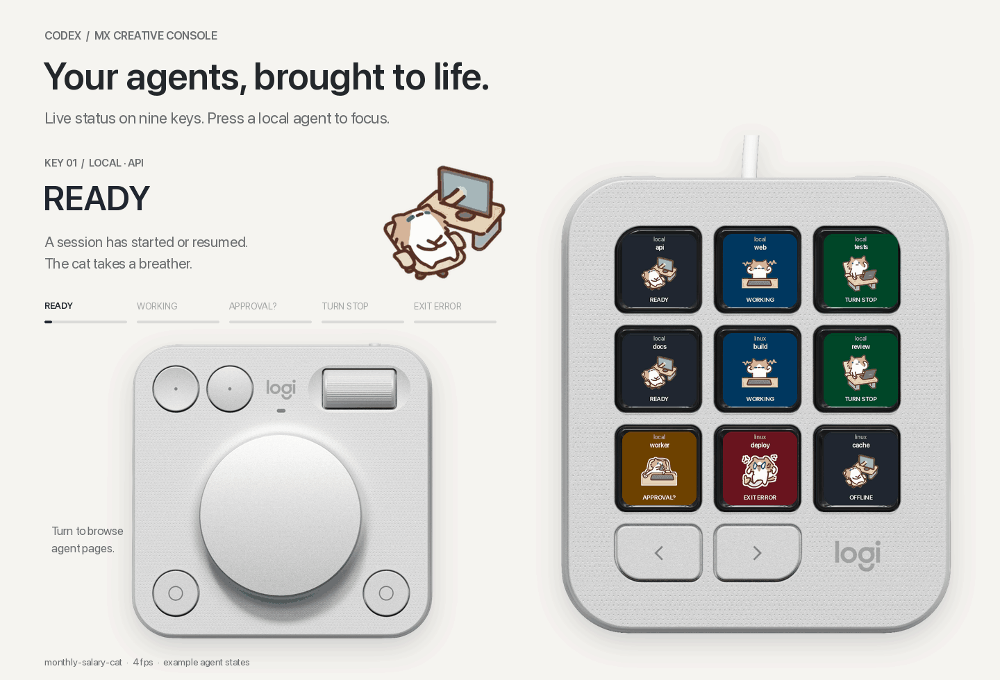

# Codex MX Bridge

Display Codex, Claude Code, and Kiro CLI lifecycle events on Logitech MX Creative Console. Runs beside
Herdr and can collect Linux-hosted agents over SSH. This is a working source
implementation with portable tests and an SDK-validated plugin package; physical
hardware and macOS integration still need the acceptance checks below.

Repository: [toby-wong/codex-mx-bridge](https://github.com/toby-wong/codex-mx-bridge)
(public). Version 0.3.0. Documentation verified 25 October 2026.



Logitech's pale-grey product render, composited with `monthly-salary-cat`.
The 16-second loop shows example agents changing state using the bridge's pet
animations and status colours at 4 fps.
[Still preview](docs/assets/console-preview.png) ·
[Pet display setup](docs/PET-DISPLAY.md) ·
[Artwork sources and regeneration](docs/assets/README.md).

## What is included

* Python 3.15 bridge using only the standard library: hook handler, atomic local
  state, optional process launcher, hook installer, SSH collector, and simulator.
* Explicit [Claude Code and Kiro CLI integrations](docs/CLAUDE-KIRO.md), with
  separate session identities and settings that survive bridge upgrades.
* C# .NET 8 plugin built against the official Logi Actions SDK `PluginApi.dll`.
  Nine slot actions, a page adjustment for the dial, and a next-page button.
* Optional local pet sprite-sheet import and animated button theme, with
  configurable chat, location, client and status labels, 1–8 requested fps,
  still poses, and text fallback. Import uses the
  optional Pillow 13 extra; hooks/SSH remain standard-library-only.
* Direct iTerm2 pane focus on a button press. Local and remote Herdr Codex chats
  support focus with an explicit [terminal binding](docs/HERDR-FOCUS.md),
  including clients attached through `herdr --remote`.
* Unit/integration tests, a real-CLI offline hook smoke test, and build/pack tools.
  A three-platform CI template is supplied in `ci/`; enabling it requires GitHub
  workflow permission, which the publishing sign-in did not have.
* `install.sh` for macOS setup and Linux hooks/export setup. It obtains Python
  3.15 if needed, preserves existing hook configuration, and checks the install.
* [Verified interfaces and limitations](docs/INTERFACES.md),
  [SSH and Herdr setup](docs/REMOTE-AND-HERDR.md),
  [test evidence](docs/VALIDATION.md), and a separate
  [Herdr extension assessment](docs/HERDR-EXTENSION-ASSESSMENT.md).
* [Community pet installation and per-chat pet rules](docs/PET-DISPLAY.md#download-a-community-pet).
  Choose a default pet and override it by client, local/remote source, host, or
  individual chat. Pet artwork is downloaded separately from Codex Pets.
* [Marketplace publishing assessment](docs/MARKETPLACE-PUBLISHING.md), including
  the official submission route and remaining distribution work.

No OpenAI API key is needed by the bridge. Codex retains its own normal login.
No Codex internal database, transcript parser, terminal screen scraper, or
undocumented Logitech socket is used.

## How it works

```text
Mac Codex CLI hooks ----> private state.json ----> Logi Actions C# plugin
                                                    | nine LCD actions
Linux Codex CLI hooks --> Linux state.json            | dial changes page
                                 |                   v
                         OpenSSH export <---- Mac collector
```

The plugin reads the Mac state file every 500 ms. Local hooks finish immediately
after a short locked write. The SSH collector normally polls every three seconds;
one collector runs per Linux host. Local collection needs no background server.

State lives at `~/.local/state/codex-mx-bridge/state.json` on both systems.
Mac display settings live at `~/.config/codex-mx-bridge/display.json`.
The state file retains a project basename or explicit label, IDs, event names, timestamps,
and local terminal identifiers, including local Herdr socket paths. Prompt text,
command arguments, tool results, and assistant messages are discarded. Remote exports remove terminal
identifiers and do not recursively export other remote hosts.

## macOS setup

With Codex CLI and Logi Options+ already installed, run this in iTerm2:

```sh
git clone https://github.com/toby-wong/codex-mx-bridge.git
cd codex-mx-bridge
bash install.sh
```

For the ZIP, extract it, enter its `codex-mx-bridge` folder, and run the same script. It copies
the necessary source to a stable user-local location, so moving the downloaded
folder afterwards does not break the hooks.

The installer:

1. Uses an existing stable Python 3.15 or obtains a private runtime using pinned
   uv 0.13.5. It does not change your default Python or shell configuration.
2. Creates `~/.local/share/codex-mx-bridge/venv-3.15`; default installation has no
   pip dependencies. `--with-pets` adds the optional Pillow importer.
3. Stages a versioned source release and runs an isolated hook self-check.
4. On Mac, uses the real Options+ SDK; obtains a private .NET 8 SDK if needed,
   builds the plugin, and creates its development link. An existing verified
   CodexMx package/link is backed up before replacement. Other plugins remain intact.
5. Backs up and merges `hooks.json`, retaining Herdr's handlers. If user-level
   hooks are explicitly disabled, it enables them with a backed-up, semantically
   verified TOML edit. Managed policy and Codex hook trust are not bypassed.
6. Writes a launcher and `installation.json` recording the installed paths.

If Options+ is missing and you have Homebrew, use `bash install.sh --install-options`
to run its cask installer. Vendor/macOS setup or a reboot may require rerunning
the bridge installer. Without Homebrew, install Options+ from Logitech first.
The bridge does not install or replace Codex CLI or log you into it.

## Updating an existing installation

From this checkout:

```sh
bash update.sh
```

This installs the current checkout using the existing runtime and registered hook
configuration paths. It selects a compatible cached SDK, rebuilds the plugin, and restarts
Logi Plugin Service on Mac. Pet assets/settings, agent state, terminal bindings,
and button assignments are retained. Old releases and an installation-manifest
backup remain available.

To activate local Herdr focus during the upgrade, run this from the **outer
local iTerm2 shell** that will display Herdr:

```sh
bash update.sh --bind-herdr "$HOME/.config/herdr/herdr.sock"
```

Then attach that terminal to Herdr and review the updated Codex hooks in
`/hooks`. Restart/resume Codex if it still uses the previous hook command.
For another Herdr session, supply its actual socket path. See
[Herdr focus setup](docs/HERDR-FOCUS.md).

Use `--dry-run` to preview, `--no-restart` to defer plugin reload, `--prefix PATH`
for a custom install, or `--sdk PATH` to override SDK selection. `--no-downloads`
requires existing dependencies. The updater uses the local source as-is; it
does not pull, reset, stash, or otherwise modify Git. Fetch/merge upstream
changes separately when desired.

Existing Linux/hooks-only installations use the same command and keep that
installation mode. Codex hook trust remains a manual step.

## Installation options

Useful variants:

```sh
bash install.sh --dry-run
bash install.sh --no-downloads --python /absolute/path/to/python3.15
bash install.sh --codex-home /absolute/custom/codex/home
bash install.sh --prefix "$HOME/Developer/codex-mx-installed"
```

The default launcher is `~/.local/share/codex-mx-bridge/bin/codex-mx`. A custom
`XDG_DATA_HOME` or `--prefix` changes this path; the installer prints the exact one.
It does not add the launcher to PATH automatically.

Two setup steps still need your UI:

1. Restart Codex and review/trust the new bridge entries in `/hooks`. **Codex
   requires this review for non-managed hooks.** Untrusted definitions are
   skipped. The installer cannot bypass it. Update an older CLI if `/hooks`
   or the documented events are unavailable.
2. Restart **Logi Plugin Service** in Options+ settings. Map **Codex MX Bridge →
   Agents → Agent slot 1** through **9** to the LCD keys, and **Agent pages** to
   the dial. Alternatively map **Next agent page** to an available button.

Then run `codex` normally. To add optional process heartbeat/exit tracking:

```sh
~/.local/share/codex-mx-bridge/bin/codex-mx run --label api -- codex
~/.local/share/codex-mx-bridge/bin/codex-mx status
```

The wrapper inherits the terminal. Its ten-second heartbeat proves process
liveness rather than model progress. Without it, a row becomes `STALE` after
15 minutes without events; with it, after 45 seconds without a heartbeat.

Pressing a direct local row can focus its original iTerm2 pane. Local and remote
Herdr rows select their current Codex pane and activate a configured iTerm2 window;
see [Herdr terminal binding](docs/HERDR-FOCUS.md). macOS Automation consent may
be required. Remote focus also needs a working noninteractive SSH connection;
status works without focus permission. See
`~/.local/state/codex-mx-bridge/focus-status.txt`.

Manual alternative: use `python3.15 bridge.py install-hooks --apply`, review
`/hooks`, and install `dist/CodexMx_0_3_0.lplug4` from the ZIP by double-clicking.
Do not install that package alongside the source installer's development link.
The standalone hook command does not edit `config.toml`; the full installer does
so only when needed to enable explicitly disabled hooks.

## Optional animated pet buttons

From the updated project folder on the Mac, provide a local Codex/ChatGPT pet sheet:

```sh
bash install.sh --with-pets --pet-sheet "$HOME/Downloads/my-pet.png" --pet-name buddy
```

The pet theme animates work/wait/review/error poses. Default requested rate is
4 fps; motion can be disabled. Switch themes
without a rebuild after installing this plugin version:

```sh
~/.local/share/codex-mx-bridge/bin/codex-mx display --motion off
~/.local/share/codex-mx-bridge/bin/codex-mx display --mode text
~/.local/share/codex-mx-bridge/bin/codex-mx display --mode pet --pet buddy --fps 4
```

Chat name, local/remote location, client and status captions can each be hidden
through `~/.config/codex-mx-bridge/display.json`. Hiding all captions leaves
just the pet; hiding status text retains its state animation. Saved Codex chat
names and explicit per-chat names are supported. Settings reload within 500 ms
without reinstalling the plugin. See [button label controls](docs/PET-DISPLAY.md#configure-button-labels).

No installable pet sprite pack is bundled or automatically extracted from the app.
The README shows a rendered example. Supply a compatible PNG/WebP sheet;
built-in/app versions with different layouts need
an explicit layout file. The bridge does not follow the app's current pet.
See [formats, status mapping, import commands, and limits](docs/PET-DISPLAY.md).
Linux requires no additional dependency for this Mac display option.

## Status meanings

These are observations, not a complete agent state machine. In particular,
`APPROVAL?` means a permission hook ran; another hook might resolve it immediately.

| Display | Last observation |
| --- | --- |
| `READY` | Session started or resumed |
| `WORKING` | Prompt submitted, tool returned, or compaction finished |
| `TOOL` | A supported local tool is about to run |
| `APPROVAL?` | Codex or Claude was about to request permission |
| `COMPACT` | Compaction started |
| `TURN STOP` | Main turn reached the Stop hook; another hook may continue it |
| `TURN ERROR` | Claude reported a turn failure; a new prompt can resume the session |
| `STOPPED` | Subagent reached SubagentStop; continuation is still possible |
| `INTERRUPTED` | Main turn interrupted |
| `CLOSED` | SessionEnd observed, or optional wrapper child exited with code 0 |
| `EXIT ERROR` | Wrapper child exited nonzero; no claim about individual tool failures |
| `NO HOOKS` | Launcher is alive but no hook has reached this run yet |
| `STALE` | Liveness/event age exceeded its threshold |
| `OFFLINE` | SSH poll failed, or collector has been silent for 15 seconds |
| `NO DATA` / `READ ERROR` | Hook data missing or unreadable; inspect the bridge directory |

By default, each tile shows its client, location and saved chat name or project
label. These captions can be configured independently. Child rows have a `>` prefix.
Rows retain registration order; active rows do not jump between keys on every
event in the default view. Completed rows remain until cleared. Each host retains at most 256 local
rows; eviction increments a visible `PRUNED` indicator. Page with the dial.

For more than nine chats, assign **Agent pages** to the dial or **Next agent
page** to a spare control. For one page of nine selected chats, set `chat_view`
in `display.json` to `recent` (latest activity), `recent_open` (latest activity
excluding finished chats), or `newest` (recorded creation time). Use `paged`
to restore all pages. Settings reload without a plugin restart:

```sh
~/.local/share/codex-mx-bridge/bin/codex-mx display --chat-view recent_open
```

See [paging, recent views and older-row compatibility](docs/CHAT-VIEWS.md).

```sh
# Remove closed/stopped/expired local history; active recent rows remain.
python3.15 bridge.py clear
# Remove only the named remote cache.
python3.15 bridge.py clear --remote linux-desktop
```

## Herdr and remote Linux

**Herdr can coexist with this bridge.** Its Codex integration and this installer
both use `hooks.json`; merge the entries rather than replacing that file. Install
the bridge on every machine that actually runs Codex, including Linux. Merely
installing it on the Mac does not instrument a remote Codex process.

For commands, connection recovery, and limitations, follow
[SSH and Herdr setup](docs/REMOTE-AND-HERDR.md). The separate assessment examines
whether Herdr's own event/status API would justify an additional adapter or plugin;
that integration is not required for this version's hook transport.

## Build, tests, and simulated data

Install the .NET 8 SDK to build or run C# tests. The plugin references the real
Logitech API supplied by Options+. It never silently substitutes a fake SDK.
If you only have the installer-managed Python, use
`~/.local/share/codex-mx-bridge/venv-3.15/bin/python` in place of `python3.15`
in the manual commands below.

```sh
python3.15 scripts/test_all.py
python3.15 tests/codex_hook_smoke.py
python3.15 scripts/build_plugin.py --link
```

The real-CLI test uses a loopback fixture with a temporary `CODEX_HOME`, no user
credentials, and no external model. Its trust-bypass flag applies only to the
test's temporary generated hook scripts; normal setup uses `/hooks` review.

If the API DLL is installed elsewhere:

```sh
python3.15 scripts/build_plugin.py --sdk '/actual/path/PluginApi.dll' --link
```

Package and verify with the tested .NET 8-compatible tool version:

```sh
dotnet tool install --global LogiPluginTool --version 6.1.4.22672
# Include ~/.dotnet/tools in PATH if required by your .NET installation.
python3.15 scripts/build_plugin.py --pack
```

The latest tool package failed installation under this test machine's .NET 8 SDK;
version `6.1.4.22672` installed, supplied the real SDK assembly, and successfully
packed/verified the plugin. A newer compatible .NET SDK may support the latest tool.
The host still supplies `PluginApi.dll` at runtime; it is not redistributed here.

Without hardware, generate isolated synthetic events:

```sh
python3.15 bridge.py --state-dir /tmp/codex-mx-demo demo
python3.15 bridge.py --state-dir /tmp/codex-mx-demo status
```

The plugin uses the default directory unless **Logi Plugin Service's own**
environment contains `MX_CODEX_STATE_DIR`. Setting it only in a terminal does
not change the environment of an already-running GUI service. Keep the default
for normal installation; the demo is primarily for tests and inspection.

## macOS and hardware acceptance checks

These require your Mac, current Options+, iTerm2, and console. They have not been
claimed as passed on the Windows build machine.

1. Trust the hooks, start a fresh Codex session, and confirm a non-demo row appears.
2. Submit a prompt; confirm the keys refresh without pressing them.
3. Trigger a normal approval request under your existing approval settings; the
   `APPROVAL?` state may be brief. Do not change security settings just for this check.
4. End and interrupt separate turns; compare `TURN STOP` and `INTERRUPTED`.
5. Run two direct iTerm panes with distinct labels; press each key and confirm focus.
6. Run an agent inside Herdr; confirm both integrations receive hooks. Bind its
   outer iTerm2 pane and press the tile. Verify the correct Herdr chat and Mac
   window, including with multiple clients attached. An unbound row must report
   `NO FOCUS`; it must not use the Herdr server's inherited iTerm ID.
7. Configure SSH collection; disconnect it and confirm `OFFLINE`, then reconnect
   and confirm recovery. The Linux agent should continue while the Mac is detached.
8. Create more than nine rows and check dial paging and compact tile legibility.

## Uninstall and troubleshooting

```sh
# Preview, then remove only bridge hook handlers. Existing Herdr hooks survive.
python3.15 bridge.py install-hooks --remove
python3.15 bridge.py install-hooks --remove --apply
```

Restart Codex after removal. Stop SSH collectors, remove the plugin through
Options+ or LogiPluginTool, and remove `CodexMxPlugin.link` from the macOS Plugin
Service Plugins directory if you used `--link`. The source and state directories
can then be deleted manually if you no longer need them. No LaunchAgent is
installed automatically and no system settings are changed by the bridge.

For a scripted installation, remove hooks with the installed launcher instead:

```sh
~/.local/share/codex-mx-bridge/bin/codex-mx install-hooks --remove --apply
```

Remove the development link and restart Logi Plugin Service before manually
removing the install/runtime directories. Installer backups are stored beside
the changed config files, or under the install prefix for a previous plugin.

* Missing data: check the effective `CODEX_HOME`, `/hooks` trust, feature policy,
  and absolute Python/project paths. Restart existing Codex sessions after setup.
* Hooks fail: a generic `hook-error.txt` records failure without prompt content.
  Corrupt `state.json` is preserved rather than overwritten. Stop writers,
  rename the corrupt file for diagnosis, then restart. The advisory handler
  exits 0 and emits `{}` even on bridge errors.
* Plugin missing: restart Logi Plugin Service; check the installed SDK path,
  package validation, and Options+ action picker. Do not install both a `.link`
  and packaged copy of the same plugin simultaneously.
* Focus missing: check `focus-status.txt` and macOS Automation settings. Local
  and remote Herdr sessions need a [terminal binding](docs/HERDR-FOCUS.md) and
  matching native Codex identity. For `herdr --remote`, bind the collector source
  alias, SSH target, remote Herdr executable/session, and outer Mac iTerm UUID.
  Plain SSH sessions without Herdr have no automatic focus target.
* Remote data missing: run the `collect-ssh --once` command first and inspect the
  stored remote error. SSH aliases and host keys must already work noninteractively.

See [the interface audit](docs/INTERFACES.md) before extending the protocol.
